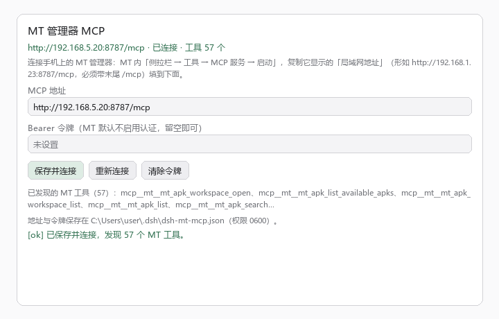

# dsh-mt-mcp

[](https://github.com/deepseek-ai/deepseek-harness)
    

连接手机上的 **MT 管理器**（[mt.cc](https://mt.cc)）与 **DeepSeek Harness（DSH）** · Connect **MT Manager** ([mt.cc](https://mt.cc)) on your Android phone to **DeepSeek Harness (DSH)**.

> 本页默认显示**简体中文**。英文版在下方折叠区，点开即在当前页面展开，不会跳转。
>
> This page shows **简体中文** by default. The English version is collapsed below — expand it in place, without leaving this page.

<details>
<summary><b>English version</b>（点击展开 / click to expand）</summary>

<br>

Connect **MT Manager** ([mt.cc](https://mt.cc)) on your Android phone to **DeepSeek Harness (DSH)**.

MT Manager ships an MCP server: start it on the phone and it becomes a **Streamable HTTP** MCP endpoint exposing phone files, APK, and ZIP capabilities. This plugin is the **desktop-side client** — a DSH plugin bundle that brings MT's tools into DSH sessions and adds a settings panel where the address can be changed at any time.

Once connected, MT's capabilities appear as `mcp__mt__*` tools, so you can just ask in plain language:

```
Read test.txt in MT's Home folder and summarize it. Don't modify anything yet.
Analyze the startup flow of the current APK and explain the relevant classes and methods.
Pack the project folder in Home into project.zip at the archive root.
```

### Why this exists

DSH's built-in MCP client (`@deepseek-ai/dsh-mcp-client`) is configured through the composition: changing the endpoint means editing a profile patch file and restarting the Host. But a phone's LAN IP **changes** — DHCP lease renewal, a different Wi-Fi, a hotspot.

This plugin moves "where to connect" out of configuration files and into the Web settings page: type the address, save, and it reconnects. No restart, no YAML.

### Install

Requires a working DSH (`dsh web` opens the UI).

**Compatible with DSH `0.2.0-rc.2` and later** (`0.2.x`). The plugin has **no runtime third-party dependencies**: the MCP protocol is implemented in `lib/mcp-http.js` using Node's built-in `fetch`, and the only import is DSH's own `@deepseek-ai/dsh-tools`. Any install method works, and `pnpm install` is never needed.

#### One-line install (recommended)

```bash
dsh plugin --profile web add github:aikunx/dsh-mt-mcp
```

Then **refresh the Web page once** — a newly installed client plugin has to be reloaded. "MT Manager" then appears in the settings sidebar.

> Using a different profile? Replace `web`. The Electron-managed `desktop` profile is handled by the app itself and does not go through this command.
>
> `dsh plugin` forwards its arguments to pnpm verbatim, so any pnpm-supported spec works. To pin a commit:
> `dsh plugin --profile web add github:aikunx/dsh-mt-mcp#<commit-sha>`

#### Install from the plugin market

Add this index URL to the Plugins settings page, then install from the Discover tab:

```
https://raw.githubusercontent.com/aikunx/dsh-mt-mcp/main/market.json
```

#### Local development

```bash
git clone https://github.com/aikunx/dsh-mt-mcp.git
cd dsh-mt-mcp
dsh plugin --profile web add .
```

No dependency install needed. Alternatively, have the Agent driving your session call `plugin_manager(action: "install_bundle", target: "<absolute clone path>")`.

> If the plugin row reports `ERR_MODULE_NOT_FOUND` with a path pointing at a **previous** install location, the Host process cached the old module resolution — restart DSH.

### The panel



Settings → MT Manager: enter the address and an optional token, then save to connect. The panel lists discovered tools and shows the config file path.

> The image is drawn from the panel source's layout and sizing, to convey the information structure. Actual appearance follows your DSH theme (light/dark).

### Usage

1. On the phone: MT Manager → **sidebar → Tools → MCP Service → Start**.
2. Copy the address MT shows. DSH runs on your computer, so use the **LAN address**, e.g. `http://192.168.5.20:8787/mcp`.
   - The trailing `/mcp` is required; the default port is `8787`.
   - **Do not use `127.0.0.1`** — that points at the computer itself, not the phone.
3. In DSH: **Settings → MT Manager**, paste the address, then "Save and connect".
4. A green status line means connected, and the panel lists the discovered tools (measured: MT 2.26.x exposes **57**).

#### The address changes; edit it any time

Edit the address in the panel and save — **no DSH restart needed**. It reconnects immediately and replaces both the old connection and the registered tools.

Set a **static IP / DHCP reservation** for the phone on your router to avoid editing it at all.

#### Bearer token (optional)

MT has authentication **off** by default: anyone who can reach the port can call it. Enable Bearer token auth under MT's **Settings → Authentication**, then paste the token into the panel's token field:

- The token is created by MT; it is unrelated to any model API key.
- Leaving the field empty keeps the current token; only "Clear token" removes it.
- It is echoed only as `abcd****wxyz` — the full token never appears in any output.
- Authentication does **not** encrypt HTTP. Use it on a trusted LAN only, and **never expose port 8787 to the internet**.

### What it can do

The tools come from MT; this plugin only forwards them. Three groups by name:

| Prefix | Purpose |
| --- | --- |
| `mcp__mt__mt_file_*` | Phone files: list directories, search by name/content/size/time, read and write text and bytes, move and delete, create directories |
| `mcp__mt__mt_apk_*` | APK: open a workspace, analyze manifest/resources/smali/so, edit, rebuild and sign, manage workspaces |
| `mcp__mt__mt_zip_*` | ZIP: browse, read entries, verify integrity, create, add/replace/delete entries, extract |

Plus two helper tools from this plugin:

| Tool | Purpose |
| --- | --- |
| `mt_mcp_status` | Show address, connection state, tool count, last error (never echoes the token) |
| `mt_mcp_connect` | Reconnect using the saved address |

#### The phone decides the access scope

Which files are reachable is **entirely decided by MT's file access rules**; this plugin offers no bypass. The measured default is "the Home folder is read-write, everything else is denied":

- Home defaults to `/storage/emulated/0/MT2/mcp` (changeable in MT's **Settings → General**).
- To read outside Home, add a rule for that directory in MT's **Settings → Files**.
- Files inside Home **cannot** be tightened to read-only; put files needing read-only protection outside Home and grant them individually.

Only you can change these rules, on the phone.

### Disconnects and reconnects

- On disconnect it retries with **1s → 2s → 4s … 30s** backoff, up to 10 attempts. After that, press "Reconnect" in the panel.
- Android may kill MT in the background. Enable **floating ball** in MT's **Settings → General** and grant the overlay permission; this markedly improves survival.
- Restarting MT's service or the phone changing IP will drop the connection. Edit the address and save, or press "Reconnect".
- Phone and computer must be on the **same LAN**. Guest Wi-Fi, AP isolation, and VPNs can all prevent connection.

### Security boundary

| Item | Detail |
| --- | --- |
| Config storage | `~/.dsh/dsh-mt-mcp.json`, mode `0600` |
| Settings routes | `/api/dsh-mt-mcp/*` accepts **loopback requests only** (verified via source IP, Host header, Origin), so nobody else on the LAN can change your config |
| Token echo | Always masked; the full token exists only in the config file above |
| Transport encryption | **None**. MT's MCP service is plain HTTP; trusted LAN only |
| Where data goes | The phone performs the operation and returns results to the AI tool, which may forward them to a model service. Only expose files you are willing to hand to them |

### Gotcha: why this plugin has zero runtime dependencies

Worth recording; it cost most of a day.

The first implementation imported `@modelcontextprotocol/sdk` directly. A local `link:` install blew up immediately:

```
Error [ERR_MODULE_NOT_FOUND]: Cannot find package 'zod'
  imported from .../node_modules/@modelcontextprotocol/sdk/dist/esm/server/zod-compat.js
```

The cause: **DSH loads plugins with symlink resolution preserved** (`--preserve-symlinks` semantics), while pnpm puts a package's dependencies inside its `.pnpm` virtual store:

```
node_modules/dsh-mt-mcp -> .pnpm/dsh-mt-mcp@.../node_modules/dsh-mt-mcp
                         ^ only this sibling directory has @modelcontextprotocol/sdk
```

Resolving upward from the symlink's real path, the SDK's transitive dependencies (`zod`, `zod-to-json-schema`, …) are not one level up, so resolution fails. Flattening with `--config.node-linker=hoisted` fixes the local-link case, but **tarball / git / market installs each produce a different layout**, so users could still fail after installing.

**The fix: reduce dependencies to zero.** MCP's Streamable HTTP is just POSTed JSON-RPC plus SSE responses — about a hundred lines on Node's built-in `fetch`, which became `lib/mcp-http.js`. The plugin now imports only DSH's own `@deepseek-ai/dsh-tools` and Node built-ins, so every install method loads directly with no `pnpm install`.

The cost is implementing a slice of the protocol (initialize / tools/list / tools/call / notifications + session header) and not supporting stdio, resources, prompts, or sampling. For "connect to MT", that is enough.

### Layout

```
dsh-mt-mcp/
├── package.json          # package + DSH bundle declaration (dsh.bundle.patch / dsh.client)
├── cordis.patch.yml      # inserts the mt-mcp row into the profile
├── market.json           # plugin market index (format 1)
├── icon.svg
├── lib/
│   ├── index.js          # Host half: connection, mcp__mt__* registration, /api/dsh-mt-mcp/* routes, helpers
│   ├── mcp-http.js       # dependency-free MCP Streamable HTTP client
│   └── client.js         # Client half: the "MT Manager" settings panel
├── docs/
│   └── settings-panel.png
└── README.md             # bilingual in one page: Chinese by default, English collapsed
```

`lib/mcp-http.js` handles JSON-RPC over HTTP: it remembers `Mcp-Session-Id`, negotiates the protocol version, parses both `application/json` and `text/event-stream` responses, and recognizes `notifications/tools/list_changed`. `lib/index.js` registers each `tools/list` result on `ctx.tools` under an `mcp__mt__` prefix (adding a hash suffix when a name is too long or contains invalid characters).

### Security review notes

If you are reviewing this plugin before installing, these are the only places it touches the outside world. Everything else is bookkeeping.

**Outbound network** — there is exactly one destination: the MCP endpoint the user typed into the settings panel (`lib/mcp-http.js`). No telemetry, no analytics, no fixed third-party host, no update pings. The only URL literals in `lib/` are `https://mt.cc` in a comment and `http://192.168.1.23:8787/mcp` as an input placeholder.

**Filesystem** — the only write is the plugin's own config, `~/.dsh/dsh-mt-mcp.json`, created with mode `0600` (`lib/index.js`). No other path is written, and nothing is deleted.

**Credentials** — the optional MT bearer token is read from the panel, stored only in that config file, and sent only as an `Authorization` header to the user's configured endpoint. It is never logged and echoed only masked (`abcd****wxyz`). No `process.env` reads.

**No dynamic code** — no `eval`, `new Function`, `vm`, `child_process`, or shell invocation anywhere. No crypto-mining or download-and-execute patterns.

**Local routes** — `/api/dsh-mt-mcp/*` refuses any request that is not loopback (source IP, `Host`, and `Origin` are all checked), so nothing on the LAN can read or rewrite the configuration.

**Third-party code** — none at runtime. `package.json` declares no `dependencies`; the MCP client is the plugin's own `lib/mcp-http.js`.

### Known limitations

- **Streamable HTTP only.** MT's MCP service is HTTP-based; there is no stdio branch.
- `lib/mcp-http.js` implements only initialize / tools/list / tools/call and tool-change notifications; resources, prompts, and sampling are not implemented (MT does not offer them).
- Tool descriptions and parameter schemas come **verbatim from MT**; this plugin adds no validation.
- Image/audio MCP content blocks keep only a type marker; **their payloads are not retained**.
- A single tool call times out after **180 seconds** (APK rebuilds can be slow, so there is headroom).
- DSH must provide the `tools`, `systemPrompt`, and `webServer` services.

</details>

---

把手机上的 **MT 管理器**（[mt.cc](https://mt.cc)）接进 **DeepSeek Harness（DSH）**。

MT 管理器自带 MCP 服务：在手机上点一下启动，它就把自己变成一个 **Streamable HTTP** 的 MCP 服务器，对外提供手机文件、APK、ZIP 三类能力。本插件是**电脑这一侧的客户端** —— 一个 DSH 插件包，把 MT 的工具接进 DSH 会话，并在 DSH 的 Web 设置页提供一个可随时修改地址的面板。

连上之后，MT 的能力以 `mcp__mt__*` 工具出现在会话里，直接用自然语言让 AI 操作手机：

```
请用 MT 读取 Home 里的 test.txt，概括内容，先不要修改。
请分析当前 APK 的启动流程，说明相关类和方法。
请把 Home 中 project 文件夹打包为 project.zip，放在压缩包根目录。
```

## 为什么需要它

DSH 自带的 MCP 客户端（`@deepseek-ai/dsh-mcp-client`）走组合配置，改一次连接地址要改 profile 的 patch 文件并重启 Host。而手机的局域网 IP 是**会变**的 —— DHCP 换租约、换 Wi-Fi、开热点，地址就变了。

本插件把「连哪里」从配置文件搬到了 Web 设置页：地址填在输入框里，保存即重连，不用重启、不用改 YAML。

## 安装

前提：DSH 已装好并且能用（`dsh web` 能打开界面）。

**兼容 DSH `0.2.0-rc.2` 及以上**（`0.2.x`）。本插件**没有任何运行时第三方依赖**：MCP 协议用自带的 `lib/mcp-http.js` 实现（Node 内置 `fetch`），只依赖 DSH 本身提供的 `@deepseek-ai/dsh-tools`。所以无论用哪种方式安装都不会出现依赖解析问题，也不需要 `pnpm install`。

### 一键安装（推荐）

复制这一行到终端：

```bash
dsh plugin --profile web add github:aikunx/dsh-mt-mcp
```

装完 **刷新一次 Web 页面**（新装的客户端插件需要重新加载），设置侧栏就会出现「MT 管理器」。

> 如果你用的是别的 profile，把 `web` 换成对应名字；桌面端 Electron 托管的 `desktop` profile 由应用自己管理，不走这条命令。
>
> `dsh plugin` 会把参数原样转给 pnpm，所以任何 pnpm 支持的 spec 都能用，例如固定到某个提交：
> `dsh plugin --profile web add github:aikunx/dsh-mt-mcp#<commit-sha>`

### 从插件库安装

在设置页「插件」里把本插件的市场索引 URL 加进去，然后在 Discover 页安装：

```
https://raw.githubusercontent.com/aikunx/dsh-mt-mcp/main/market.json
```

### 本地开发

```bash
git clone https://github.com/aikunx/dsh-mt-mcp.git
cd dsh-mt-mcp
dsh plugin --profile web add .
```

无需安装依赖。或者让支撑本会话的 Agent 调用 `plugin_manager(action: "install_bundle", target: "<克隆目录绝对路径>")`。

> 安装后如果插件行报 `ERR_MODULE_NOT_FOUND` 且路径指向你**之前**的安装位置，那是 Host 进程缓存了旧的模块解析结果 —— 重启 DSH 即可。

## 界面


设置 → MT 管理器：填地址、可选令牌，保存即连接；下方列出已发现的工具，并显示配置文件路径。

> 上图按面板源码的布局与尺寸参数绘制，用于说明信息结构；实际外观随你的 DSH 主题（深/浅色）变化。

## 使用

1. 手机打开 MT 管理器 → **侧拉栏 → 工具 → MCP 服务 → 启动**。
2. 复制 MT 显示的地址。DSH 跑在电脑上，所以要用**局域网地址**，形如 `http://192.168.5.20:8787/mcp`。
   - 末尾的 `/mcp` 不能少，端口默认 `8787`。
   - **不要用 `127.0.0.1`** —— 那指向电脑自己，不是手机。
3. 电脑 DSH 的 **设置 → MT 管理器**，粘贴地址 →「保存并连接」。
4. 状态行变绿即已连接，下方会列出发现的工具（实测 MT 2.26.x 提供 **57 个**）。

### 地址会变，随时改

面板里直接改地址再保存即可，**不需要重启 DSH**。改完立刻重连，并把旧连接和已注册的工具一起换掉。

推荐给手机在路由器上设**静态 IP / DHCP 保留**，省得每次都要改。

### Bearer 令牌（可选）

MT 默认**不开认证**，任何能连到该端口的人都能调用。在 MT 的 **设置 → 认证** 启用 Bearer 令牌认证后，把令牌填进面板的令牌框：

- 令牌是 MT 创建的，和模型的 API 密钥无关。
- 输入框留空＝保持不变；点「清除令牌」才会清掉。
- 回显时只显示 `abcd****wxyz`，完整令牌不会出现在任何输出里。
- 认证**不加密** HTTP 连接。只在可信局域网里用，**不要把 8787 端口暴露到公网**。

## 它能做什么

工具由 MT 提供，本插件只负责转发。按名称分三类：

| 前缀 | 用途 |
| --- | --- |
| `mcp__mt__mt_file_*` | 手机文件：列目录、按名称/内容/大小/时间搜索、读写文本与字节、移动删除、创建目录 |
| `mcp__mt__mt_apk_*` | APK：打开工作区、分析 Manifest/资源/Smali/so、编辑、重打包签名、工作区管理 |
| `mcp__mt__mt_zip_*` | ZIP：浏览、读条目、完整性检查、创建、增删改条目、提取 |

外加两个本插件的辅助工具：

| 工具 | 作用 |
| --- | --- |
| `mt_mcp_status` | 看地址、连接状态、工具数量、最近错误（不回显令牌） |
| `mt_mcp_connect` | 按已保存的地址重新连接 |

### 访问范围由手机决定

能操作哪些文件，**完全由 MT 里的文件访问权限规则决定**，本插件不提供任何绕过。实测默认策略是「Home 文件夹可读写，其余一律禁止」：

- Home 默认在 `/storage/emulated/0/MT2/mcp`（可在 MT 的 **设置 → 通用** 改）。
- 要读 Home 之外的文件，得先在 MT 的 **设置 → 文件** 给那个目录加规则。
- Home 里的文件**无法**收紧成只读；需要只读保护的文件放到 Home 外面再单独授权。

这些规则只有你自己能在手机上改。

## 断线与重连

- 连接断开后按 **1s → 2s → 4s … 30s** 退避自动重连，最多 10 次；到顶后在面板点「重新连接」。
- MT 切到后台可能被系统杀掉。在 MT 的 **设置 → 通用** 开启**悬浮球**并授予悬浮窗权限，能显著提高存活率。
- MT 服务重启、手机 IP 变了，都会断。改地址保存或点「重新连接」即可。
- 手机与电脑要在**同一个局域网**。访客 Wi-Fi、AP 隔离、VPN 都可能导致连不上。

## 安全边界

| 项 | 说明 |
| --- | --- |
| 配置存储 | `~/.dsh/dsh-mt-mcp.json`，权限 `0600` |
| 设置路由 | `/api/dsh-mt-mcp/*` **只接受 loopback 请求**（校验来源 IP、Host 头、Origin），局域网内其他人改不了你的配置 |
| 令牌回显 | 一律掩码，完整令牌只存在于上述配置文件里 |
| 传输加密 | **无**。MT 的 MCP 服务是明文 HTTP，仅限可信局域网 |
| 数据去向 | 手机执行操作并把结果返回给 AI 工具，AI 工具可能再把它发给模型服务。只开放你愿意交给它们处理的文件 |

## 踩坑：为什么这个插件没有任何运行时依赖

排查了大半天的坑，值得写下来。

最初的实现直接 `import '@modelcontextprotocol/sdk'`。本地 `link:` 安装时立刻炸：

```
Error [ERR_MODULE_NOT_FOUND]: Cannot find package 'zod'
  imported from .../node_modules/@modelcontextprotocol/sdk/dist/esm/server/zod-compat.js
```

原因是 **DSH 加载插件时保留符号链接解析**（`--preserve-symlinks` 语义），而 pnpm 把包依赖放进 `.pnpm` 虚拟店：

```
node_modules/dsh-mt-mcp -> .pnpm/dsh-mt-mcp@.../node_modules/dsh-mt-mcp
                         ^ 该目录的兄弟位置才有 @modelcontextprotocol/sdk
```

按符号链接真实路径向上找依赖时，SDK 的传递依赖（`zod`、`zod-to-json-schema` 等）不在上一层，于是解析失败。用 `--config.node-linker=hoisted` 平铺能缓解本地 link 场景，但**换成 tarball / git / 插件库安装时布局又不同**，用户装完照样可能失败。

**最终解法：把依赖降到零。** MCP 的 Streamable HTTP 只是「POST JSON-RPC + SSE 响应」，用 Node 内置 `fetch` 一百多行就够，于是有了 `lib/mcp-http.js`。插件现在只 import DSH 自己提供的 `@deepseek-ai/dsh-tools` 和 Node 内置模块，任何安装方式都能直接加载，不需要 `pnpm install`。

代价是实现了协议的一小块（initialize / tools/list / tools/call / 通知 + 会话头），不支持 stdio、resources、prompts、sampling。对「连 MT」这个目标够了。

## 结构

```
dsh-mt-mcp/
├── package.json          # 包与 DSH bundle 声明（dsh.bundle.patch / dsh.client）
├── cordis.patch.yml      # 往 profile 插入 mt-mcp 这一行
├── market.json           # 插件库索引（format 1）
├── icon.svg
├── lib/
│   ├── index.js          # Host 半：连接、mcp__mt__* 注册、/api/dsh-mt-mcp/* 路由、两个辅助工具
│   ├── mcp-http.js       # 零依赖 MCP Streamable HTTP 客户端
│   └── client.js         # Client 半：设置页「MT 管理器」面板
├── docs/
│   └── settings-panel.png
└── README.md             # 单页双语：中文默认，英文折叠
```

`lib/mcp-http.js` 负责 JSON-RPC over HTTP：记住 `Mcp-Session-Id`、协商协议版本、解析 `application/json` 与 `text/event-stream` 两种响应、识别 `notifications/tools/list_changed`。`lib/index.js` 把 `tools/list` 的结果逐个注册到 `ctx.tools`，工具名加 `mcp__mt__` 前缀（超长或有非法字符时加哈希后缀保证唯一）。

## 安全复核说明

如果你在安装前审计这个插件，以下是它接触外部世界的全部位置，其余都只是本地记录。

**对外网络** — 只有一个去处：用户在设置面板里填的 MCP 端点（`lib/mcp-http.js`）。没有遥测、没有统计、没有固定的第三方主机、没有更新检查。`lib/` 里的 URL 字面量只有注释中的 `https://mt.cc` 和作为输入占位符的 `http://192.168.1.23:8787/mcp`。

**文件系统** — 唯一的写入是插件自己的配置 `~/.dsh/dsh-mt-mcp.json`，以 `0600` 权限创建（`lib/index.js`）。不写其他路径，也不删除任何东西。

**凭据** — 可选的 MT Bearer 令牌从面板读入，只存在上述配置文件里，只以 `Authorization` 请求头发给用户自己配置的端点。从不记录日志，回显一律掩码（`abcd****wxyz`）。不读取 `process.env`。

**无动态代码** — 全文没有 `eval`、`new Function`、`vm`、`child_process` 或 shell 调用；没有挖矿或下载执行特征。

**本地路由** — `/api/dsh-mt-mcp/*` 拒绝一切非 loopback 请求（同时校验来源 IP、`Host`、`Origin`），局域网内其他设备无法读取或改写配置。

**第三方代码** — 运行时没有。`package.json` 不声明任何 `dependencies`，MCP 客户端是本插件自己的 `lib/mcp-http.js`。

## 已知限制

- **只支持 Streamable HTTP**。MT 的 MCP 服务是 HTTP 型，插件没做 stdio 分支。
- `lib/mcp-http.js` 只实现了 initialize / tools/list / tools/call 与工具变更通知；MT 不提供的 resources、prompts、sampling 未实现。
- 工具描述与参数 schema **原样来自 MT**，本插件不做校验增强。
- 图片/音频类 MCP 内容块只保留类型说明，**内容不落地**。
- 单次工具调用超时 **180 秒**（MT 重打包 APK 可能较慢，留了余量）。
- 需要 DSH 侧有 `tools` / `systemPrompt` / `webServer` 三个服务。

## 许可

MIT

---

## 许可 / License

MIT
